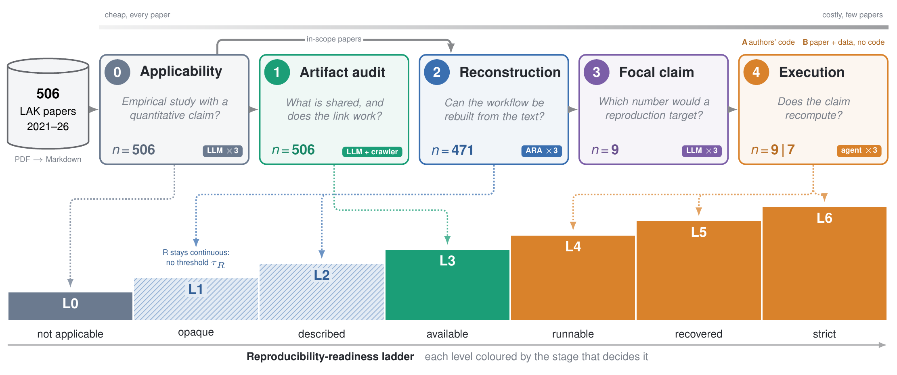

# LLM and agent cascade for assessing whether published research can be reproduced

A gated pipeline that reads a research paper, audits what it shares, reconstructs its
analysis workflow, picks the claim a reproduction would target, and finally lets sandboxed
agents try to recompute that claim. Each paper ends up on a ladder from L0 (not applicable)
to L6 (claim strictly recovered). Each stage is cheaper than the next and passes on only the
papers it can act on.

The pipeline is set up and documented for one corpus: the long and short papers of the
Learning Analytics and Knowledge (LAK) conference, 2021–2026 (506 papers, see
[Get the papers](#1-get-the-papers-not-included)).



| Stage | What it does | Details and prompts |
|---|---|---|
| 0 | Applicability screen and claim type | [docs/stage0-applicability.md](docs/stage0-applicability.md) |
| 1 | Artifact audit: stated sharing, link resolution, retrieval, environment score | [docs/stage1-artifact-audit.md](docs/stage1-artifact-audit.md) |
| 2 | ARA workflow reconstructability (R) | [docs/stage2-ara.md](docs/stage2-ara.md) |
| 3 | Focal claim extraction, reported value withheld | [docs/stage3-focal-claim.md](docs/stage3-focal-claim.md) |
| 4 | Agentic execution: Arm A (authors' code) and Arm B (paper + data, no code) | [docs/stage4-execution.md](docs/stage4-execution.md) |
| 5 | Signals against outcomes (observation only) | [docs/stage5-calibration.md](docs/stage5-calibration.md) |

[docs/pipeline.md](docs/pipeline.md) shows how the stages connect and which tables each one
writes. [docs/protocol.md](docs/protocol.md) is the frozen protocol, with the ladder, claim
tolerances, statistical tier rule and acceptance criteria. Every LLM stage uses OpenAI
`gpt-5.6-terra` at `medium` reasoning effort.

## Requirements

- Python 3.13 and [uv](https://docs.astral.sh/uv/)
- `git`
- Docker, for Stage 4 only
- An OpenAI API key with access to `gpt-5.6-terra`
- Access to the ACM Digital Library. Bulk PDF download needs **ACM DL Premium**, usually
  through an institutional subscription.

```bash
uv sync
cp .env.example .env            # then put your key in OPENAI_API_KEY
uv run python -m unittest discover tests
```

## 1. Get the papers (not included)

The LAK papers are copyrighted by ACM and are **not** in this repository, and no database is
shipped. You download them yourself and build the catalog locally.

**Which papers.** [`docs/corpus.csv`](docs/corpus.csv) lists all 506 papers with their DOI,
year, kind (long/short) and the `paper_id` the study used. The proceedings are:

| Year | Proceedings DOI | Long | Short |
|---|---|---|---|
| 2021 | [10.1145/3448139](https://dl.acm.org/doi/proceedings/10.1145/3448139) | 42 | 29 |
| 2022 | [10.1145/3506860](https://dl.acm.org/doi/proceedings/10.1145/3506860) | 39 | 23 |
| 2023 | [10.1145/3576050](https://dl.acm.org/doi/proceedings/10.1145/3576050) | 49 | 22 |
| 2024 | [10.1145/3636555](https://dl.acm.org/doi/proceedings/10.1145/3636555) | 66 | 29 |
| 2025 | [10.1145/3706468](https://dl.acm.org/doi/proceedings/10.1145/3706468) | 70 | 31 |
| 2026 | [10.1145/3785022](https://dl.acm.org/doi/proceedings/10.1145/3785022) | 66 | 40 |

**Download with ACM DL Premium bulk download.** For each proceedings volume:

1. Sign in through your institution and open the proceedings page (links above).
2. Tick **Select all** (ACM shows at most 50 items per page, so repeat this on every page).
3. Click **Download PDFs**. ACM returns a ZIP of the selected PDFs.
4. With the same selection, click **Export Citations** and choose **BibTeX**. Save the `.bib`
   file.

Put every ZIP and every `.bib` file into **one folder**, for example `~/Downloads/acm/`. You do
not need to unzip or rename anything, and it does not matter if you also selected posters,
demos or front matter. Without Premium you can download each paper from its DOI page and put
the PDFs in the same folder instead.

**Organise them.** This command builds the layout the pipeline reads and keeps only the 506
corpus papers:

```bash
uv run python scripts/organize_acm_download.py --downloads ~/Downloads/acm --out ../lak_dataset
```

```
../lak_dataset/
├── 2021/
│   ├── long/   acm.bib + 42 PDFs
│   └── short/  acm.bib + 29 PDFs
├── 2022/ …
└── 2026/
    ├── long/   acm.bib + 66 PDFs
    └── short/  acm.bib + 40 PDFs
```

The script matches PDFs by DOI filename or by title (ACM names newer files after a shortened
title). It writes the BibTeX entries in `paper_id` order, so the catalog assigns the same ids
as the study. It lists any paper it could not find, and it never modifies the download folder.

## 2. Build the catalog

```bash
uv run lakdb ingest ../lak_dataset      # BibTeX + PDFs → data/lak.sqlite
uv run lakdb validate                   # expect 506 papers, 506 matched PDFs, 0 open issues
uv run lakdb parse --workers 2          # PDF → Markdown (LiteParse with OCR; about 1 min per paper)
```

`data/`, `logs/` and `artifacts/` are created on first use and are git-ignored.

## 3. Try it on a few papers

Parsing and model calls cost time and money, so start small. Build a test catalog that holds all
506 BibTeX entries (so the paper ids stay the same) and PDFs for three papers only. Paper 69 is
ships code and data together, so it exercises every stage.

```bash
uv run python scripts/organize_acm_download.py --downloads ~/Downloads/acm --out ../lak_small \
    --paper-id 1 --paper-id 2 --paper-id 69
uv run lakdb --database data/small.sqlite ingest ../lak_small
uv run lakdb --database data/small.sqlite parse
```

Then run the stages on that database. Add `--database data/small.sqlite` before every
subcommand below (it is left out here to keep the lines short), or run on the full catalog
instead.

```bash
# Stage 0: applicability (3 repetitions per paper)
uv run lakdb experiment create s0-demo --model gpt-5.6-terra --reasoning-effort medium --repeats 3 --freeze
uv run lakdb screen run --experiment s0-demo
uv run lakdb screen finalize --experiment s0-demo

# Stage 1: artifact audit, link resolution, retrieval
uv run lakdb artifact create s1-demo --model gpt-5.6-terra --repeats 1 --freeze
uv run lakdb artifact run --experiment s1-demo
uv run lakdb artifact finalize --experiment s1-demo
uv run lakdb resolve run --experiment s1-demo --all
uv run lakdb fetch code --experiment s1-demo
uv run lakdb fetch data --budget-gb 5

# Stage 2: ARA (clone the pinned upstream once)
git clone https://github.com/AndresLaverdeMarin/agentic_reproducibility_assessment.git .external/ara
git -C .external/ara checkout e015be37d82c57e6da826ad50fe8023e9f1255f5
uv run lakdb ara create s2-demo --applicability-experiment s0-demo --model gpt-5.6-terra --reasoning-effort medium --repeats 3
uv run lakdb ara run --experiment s2-demo

# Stage 3: focal claim
uv run lakdb claim create s3-demo --ara-experiment s2-demo
uv run lakdb claim run --experiment s3-demo --paper-id 69
uv run lakdb claim aggregate --experiment s3-demo

# Stage 4: execution (Docker)
docker compose -f arm_a/compose.yaml build
uv run lakdb arm-a create s4a-demo --claim-experiment s3-demo
uv run lakdb arm-a run --experiment s4a-demo --paper-id 69
uv run lakdb arm-a collect --experiment s4a-demo
uv run lakdb arm-a verify --experiment s4a-demo
uv run lakdb arm-a compare --experiment s4a-demo
uv run lakdb arm-a report --experiment s4a-demo
```

Arm B follows the same pattern with `lakdb arm-b …` (see
[docs/stage4-execution.md](docs/stage4-execution.md)). `uv run lakdb usage` reports tokens and
cost per experiment, and `uv run lakdb dashboard` opens a terminal view of the catalog. Every
command has `--help`.

To reproduce the reference runs, use the experiment settings listed in each stage document.
The prompts in this code are byte-identical to the frozen experiments, and each stage document
gives the SHA-256 of its prompt.

## Repository layout

```
lakdb/cli.py            command-line entry point (`uv run lakdb …`)
main.py                 corpus catalog: ingest, parse, validate, search
screening.py            Stage 0
artifact*.py, environment.py   Stage 1
ara.py, ara_bridge.py, ara_analysis.py, r_analysis.py   Stage 2 and R analytics
claim.py                Stage 3
arm_a/, arm_a_runner.py Stage 4 Arm A (Inspect AI task, sandbox image)
arm_b/, arm_b_runner.py Stage 4 Arm B
agreement.py            agreement with the Haim et al. human coding
pricing.py              price table used for cost reporting
scripts/                corpus organiser, report generators, Stage 5 observation
baseline/haim-lak/      Haim et al. (2023) released coding data (CC BY 4.0)
docs/                   protocol, per-stage method and prompts, corpus list
tests/                  unit tests (no API calls)
```

Third-party code and data are listed in [THIRD_PARTY_NOTICES.md](THIRD_PARTY_NOTICES.md).

## License

Code: [MIT](LICENSE). The Haim et al. coding data in `baseline/haim-lak/` is CC BY 4.0. The ARA
pipeline used in Stage 2 is GPL-3.0 and is cloned separately, not distributed here.
